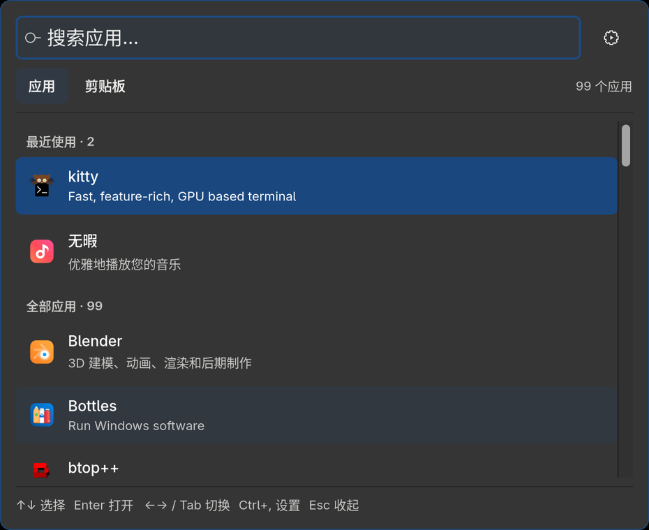
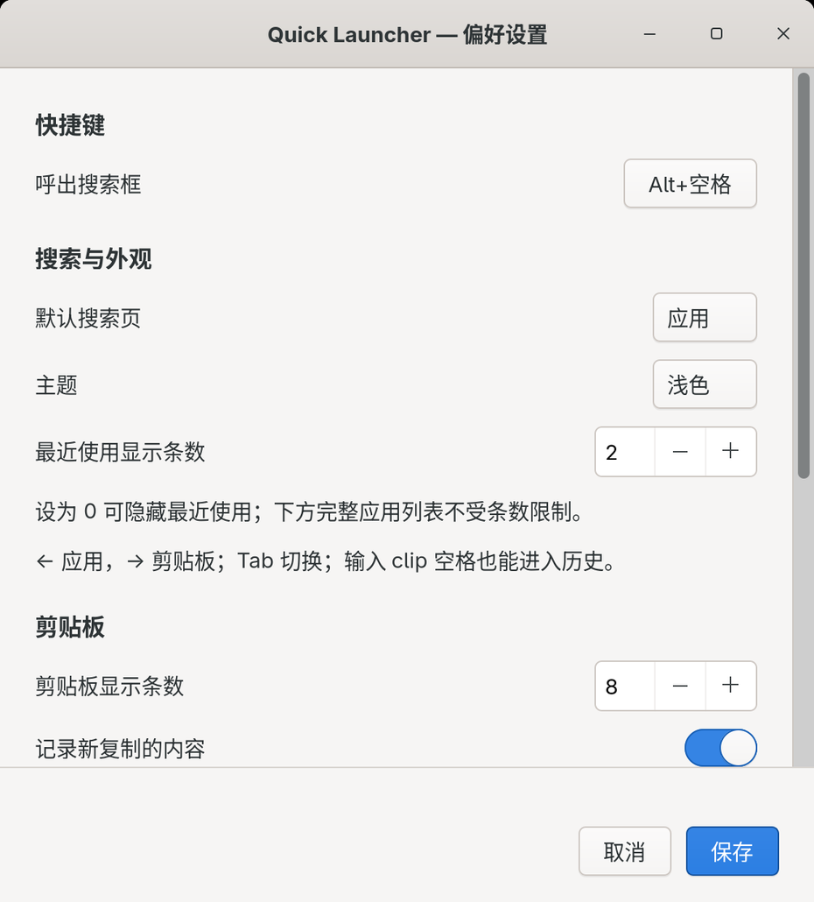

# Quick Launcher

GNOME 上的应用启动器和剪贴板历史工具。Rust + GTK4，使用原生控件和系统主题。



## 使用

- `Alt+Space` 呼出。窗口被遮挡或最小化时一次置顶，已聚焦时再次按键收起。
- 输入名称搜索应用，`↑↓` 选择，`Enter` 打开。
- 上方显示最近启动的应用，下方是完整应用列表；输入关键词同时筛选两部分。
- `←` 应用、`→` 剪贴板，`Tab` 切换；也可输入 `clip ` 搜索剪贴板。
- 剪贴板支持文字和 PNG 图片。`Enter` 复制，收起后用 `Ctrl+V` 粘贴。
- 齿轮或 `Ctrl+,` 打开设置；关闭、取消或保存后返回原页面。

设置可修改快捷键、默认页面、主题、最近使用条数、剪贴板条数、记录与保存开关、
登录自启动。最近使用默认显示 5 条，可设为 0–20，0 隐藏该分组。



## 安装

目前在 Fedora 44、GNOME 50 的 Wayland 会话上验证，窗口和后台剪贴板通过
XWayland 工作。

### 使用发行包

从 [Releases](https://github.com/cuihuir/quicker-launch/releases) 下载 Fedora x86_64
发行包，解压后在目录中运行：

```bash
sudo dnf install gtk4 wmctrl python3-gobject
python3 scripts/install.py --install --binary ./quick-launcher
```

### 从源码构建

```bash
sudo dnf install rust cargo gtk4-devel wmctrl python3-gobject
git clone https://github.com/cuihuir/quicker-launch.git
cd quicker-launch
cargo build --release --locked -j2
python3 scripts/install.py --install
```

安装到当前用户目录，创建 GNOME 快捷键和用户服务。安装器会停用占用相同快捷键
的绑定，以及旧 Ulauncher 用户服务和 Clipboard Indicator；保留它们的软件与历史。
升级只停止启动器，不关闭通过它打开的应用。回滚备份位于
`~/.local/state/quick-launcher/install-backups/`，支持 `XDG_STATE_HOME`。

```bash
quick-launcher --preferences
quick-launcher --check
python3 scripts/install.py --restore /path/to/backup/state.json
```

## 数据

配置默认在 `~/.config/quick-launcher/config.toml`，历史在
`~/.local/state/quick-launcher/`，支持 XDG 路径覆盖。剪贴板内容只保存在本机，
可暂停记录、关闭持久保存或清空历史。应用来自 `.desktop` 入口，不做全盘索引。

## 开发

```bash
cargo fmt --check
cargo test --locked -j2
cargo clippy --locked --all-targets -j2 -- -D warnings
```

入口在 `src/main.rs`，窗口在 `src/ui.rs`，配置、搜索、剪贴板和 GNOME 适配分别
在对应模块中。安装器独立处理桌面设置和回滚。许可证为 [MIT](LICENSE)。
